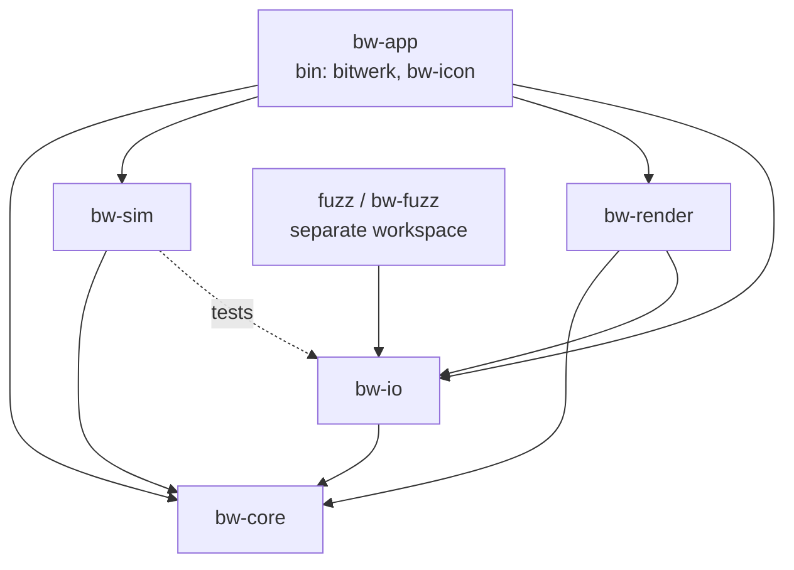

# bitwerk architecture

A map of the codebase for newcomers: what every crate and top-level folder is
for, how they depend on each other, how data moves at run time, and where to
look to change things. Behaviour, formats and performance numbers are
described in depth in the [README](../README.md) (in Portuguese); this
document links to it instead of repeating it.

## Overview

bitwerk is a digital logic circuit simulator for macOS written in Rust. Users
place gates, switches, clocks, LEDs, tri-state buffers, flip-flops, RAM/ROM,
displays and hierarchical **macros** on an integer grid and connect them with
orthogonal wires. A dedicated thread simulates the circuit event-driven with
four-state logic (0, 1, Z, X), and a wgpu (Metal) renderer embedded in an
egui/eframe window draws the canvas. Projects are saved as versioned RON
files (`.bitwerk`). Digital Works 2.x/3.x files (`.dwm`, `.dwt`, `.map`) can
be imported, and circuits and macros can be exported to `.dwm`.

## Repository layout

```
bitwerk/
├── Cargo.toml            workspace: members crates/*, shared dependency versions, lints, release profile
├── Cargo.lock
├── rust-toolchain.toml   stable channel + clippy, rustfmt
├── clippy.toml           allows unwrap/expect in tests
├── rustfmt.toml          edition 2024, max_width 120
├── deny.toml             cargo-deny: advisories, licence allow-list, bans, sources
├── Makefile              build/test/lint/fuzz/bench/icon/bundle shortcuts (`make help`)
├── README.md             user and design documentation (Portuguese)
├── LICENSE-MIT, LICENSE-APACHE
├── crates/
│   ├── bw-core/          circuit model (pure data, no I/O)
│   ├── bw-sim/           simulation engine and its thread
│   ├── bw-render/        wgpu canvas renderer, schematic symbols, WGSL shaders
│   ├── bw-io/            file formats, macro library, Digital Works import/export
│   └── bw-app/           the desktop app (binaries `bitwerk` and `bw-icon`)
├── assets/               AppIcon.icns, AppIcon-256.png (generated by `make icon`), Info.plist for the .app bundle
├── examples/             sample projects (*.bitwerk) used by the README and by tests
├── docs/
│   ├── ARCHITECTURE.md   this file
│   └── dwm/              Digital Works file format research (see docs/dwm/README.md)
├── tools/dwm_parse.py    Python reference parser of .dwm/.dwt used for the format research
└── fuzz/                 separate cargo-fuzz workspace: fuzz_targets/ and seeds/
```

## Crate dependency graph

Derived from the `Cargo.toml` files. Solid edges are `[dependencies]`, dotted
edges are `[dev-dependencies]` only.



`bw-core` is the only crate everything shares. `bw-sim` and `bw-io` do not
know about each other in normal builds, and nothing but `bw-app` depends on
`bw-sim`. Note that `bw-render` lists `bw-io` as a normal dependency, but the
only use is in a `#[cfg(test)]` test (`macro_symbols_match_core_pins` in
[`symbols/mod.rs`](../crates/bw-render/src/symbols/mod.rs)); see
[Surprises](#surprises-and-inconsistencies).

Notable external crates (versions pinned in the root
[`Cargo.toml`](../Cargo.toml)): `serde` + `ron` (files), `thiserror`,
`crossbeam-channel` + `arc-swap` (threads), `wgpu` with Metal + WGSL,
`glam`, `bytemuck`, `rstar` (R-tree), `eframe`/`egui`/`egui-wgpu` (UI),
`muda` (native macOS menu), `rfd` (file dialogs), `tracing`.

## Crates

### bw-core: circuit model

Pure, serde-serializable data with no I/O, threads or rendering. It enforces
the model invariants (orthogonal segments, at most one driver per net except
tri-state buses, parameter limits, memory sizes) on construction, on every
edit and on deserialization. See [`lib.rs`](../crates/bw-core/src/lib.rs).

| Module | Contents |
|---|---|
| [`circuit.rs`](../crates/bw-core/src/circuit.rs) | `Circuit` (components, wire graph, memories, notes, macro table, `EvalMode`), the `Edit` enum (`AddComponent`, `RemoveComponent`, `MoveComponent`, `SetRotation`, `SetKind`, `AddWire`, `RemoveSegment`, `MoveNode`, `DragSegment`, `SetMemoryWord`, `SetMemory`, `DefineMacro`, `RemoveMacro`, `SetColor`, `SetNote`, `SetEvalMode`), `Circuit::apply` returning `Applied` (what changed), `CircuitRaw` (serde form), `CircuitError` |
| [`component.rs`](../crates/bw-core/src/component.rs) | `Component`, `ComponentId`, `ComponentKind` (`Gate`, `Not`, `Switch`, `Clock`, `Led`, `TriState`, `FlipFlop`, `Memory`, `Tag`, `Macro`, `Const`, `SeqGen`, `SevenSeg`, `Numeric`, `Text`), pin geometry, rotations and all parameter limits (`MAX_*`) |
| [`wiring.rs`](../crates/bw-core/src/wiring.rs) | Wire graph: `NodeId`/`WireNode` (pins, junctions, bends), `SegmentId`/`Segment`, `Nets`, `WireEnd` |
| [`macros.rs`](../crates/bw-core/src/macros.rs) | `MacroDef` (body circuit + interface pins from `Tag` components), `MacroTable`, `MacroId`, `Package` (box or DIL), `LibraryRef`, limits, `run_macro_plan` (used by "Create Macro from Selection") |
| [`geom.rs`](../crates/bw-core/src/geom.rs) | `GridPos`, `GridRect` |
| [`memenc.rs`](../crates/bw-core/src/memenc.rs) | Compact hex-run text encoding of memory contents inside project files |
| [`note.rs`](../crates/bw-core/src/note.rs) | `Note`: text and style of `Text` annotations |
| [`stress.rs`](../crates/bw-core/src/stress.rs) | Synthetic large circuits for the stress test and benchmarks |

Depends on: `serde`, `thiserror` only. Tests:
[`tests/wiring.rs`](../crates/bw-core/tests/wiring.rs).

### bw-sim: simulation engine

Compiles a `Circuit` into a flat netlist and evaluates it with unit delay and
delta cycles, on its own thread. See [`lib.rs`](../crates/bw-sim/src/lib.rs).

| Module | Contents |
|---|---|
| [`flatten.rs`](../crates/bw-sim/src/flatten.rs) | Flattens the macro hierarchy at compile time: one cached `Template` per definition (by content hash, `FlattenCache`), nets joined across levels with union-find; per-instance scopes for the inside view and error paths |
| [`netlist.rs`](../crates/bw-sim/src/netlist.rs) | `Netlist::compile` / `compile_cached` (struct-of-arrays, CSR fan-out, bus drivers), `SimState` (`reset`, `tick`, `settle`, state transfer across recompiles), `NetMap`, `pack_levels` (2 bits per net) |
| [`logic.rs`](../crates/bw-sim/src/logic.rs) | Four-state values `L0`, `L1`, `Z`, `X` and the rules for gates, tri-states and flip-flops |
| [`engine.rs`](../crates/bw-sim/src/engine.rs) | `SimHandle` (spawns the thread), `Command`, `Snapshot`, `MemoryView`, `RunState`, `StepMode`, `MAX_TICK_RATE` |

Public error type: `SimError` (`RaceCondition`, `BusContention`, `TooLarge`).
Depends on: `bw-core`, `crossbeam-channel`, `arc-swap`, `thiserror`, `tracing`
(`bw-io` only in tests). Tests in [`tests/`](../crates/bw-sim/tests):
`sim.rs`, `components.rs`, `macros.rs`, `library.rs` (also the generator of
the built-in parts), `dwm.rs` and `dwm_export.rs` (behaviour of imported and
exported Digital Works circuits).

### bw-render: GPU canvas renderer

Toolkit-agnostic wgpu renderer; the app embeds it through an egui-wgpu paint
callback. See [`lib.rs`](../crates/bw-render/src/lib.rs).

| Module | Contents |
|---|---|
| [`camera.rs`](../crates/bw-render/src/camera.rs) | `Camera`: zoom/pan, screen ↔ world, one view-projection uniform |
| [`scene.rs`](../crates/bw-render/src/scene.rs) | `Scene`: slot-stable body/wire instance arrays plus an R-tree for picking. `Scene::build` (full, run off-thread) and `Scene::apply(circuit, &Applied, revision)` (in-place patch), dirty-slot tracking, `pick_body`, `pick_wire`, `query` |
| [`renderer.rs`](../crates/bw-render/src/renderer.rs) | `CanvasRenderer`: pipelines and buffers, `prepare` (uploads dirty slots, streams new scenes with a per-frame byte budget), `encode` / `submit_culling` (GPU compute culling), `paint`; the `NetLevels` trait the caller implements to supply live net levels |
| [`symbols/`](../crates/bw-render/src/symbols/mod.rs) | Original ANSI and IEC schematic symbols as vector paths (`mod.rs`: `SymbolKind`, `KIND_CODES`, macro and note symbols), `path.rs` (arcs/Béziers), `tess.rs` (ear clipping and stroke strips), `atlas.rs` (one static mesh atlas), `font.rs` (stroke font), `raster.rs` (CPU rasterizer for the app icon) |
| [`shaders/`](../crates/bw-render/src/shaders) | WGSL: `common`, `instances`, `grid`, `body`, `wire`, `symbol` (render) and `cull` (compute), concatenated with `include_str!` in `renderer.rs` |

Depends on: `bw-core`, `wgpu`, `glam`, `bytemuck`, `rstar`, `tracing` (and
`bw-io`, see above). Tests: [`tests/shaders.rs`](../crates/bw-render/tests/shaders.rs)
(validates WGSL with `naga`, no GPU), `scene_incremental.rs`, and
`gpu_smoke.rs` (renders on a real device; contains the ignored
`stress_frame_cost` benchmark; set `BW_SYMBOL_PNG=<dir>` to dump PNGs).

### bw-io: file formats

Everything that reads or writes files. Every file is treated as hostile input
(size caps before and during reading, bounded RON depth and object counts,
full model validation). See [`lib.rs`](../crates/bw-io/src/lib.rs).

| Module | Contents |
|---|---|
| [`lib.rs`](../crates/bw-io/src/lib.rs) | Project format (`Project`, `FORMAT_VERSION = 5`, `migrate` from versions 1 to 4), `load_from_bytes`, `load_from_path` (also routes `.dwm`), `save_to_string`, `save_to_path`, `read_capped`, `write_atomic` / `write_bytes_atomic`, `IoError`, limits |
| [`bwmacro.rs`](../crates/bw-io/src/bwmacro.rs) | `.bwmacro` single-macro files (a definition plus its dependencies): `MacroFile`, load/save |
| [`library.rs`](../crates/bw-io/src/library.rs) | Parts Centre library: built-in parts (`BUILTIN`, `include_str!` of [`library/*.bwmacro`](../crates/bw-io/library)) and user parts in `~/Library/Application Support/bitwerk/Parts` (`scan`, `save_user`, `rename_user`, `move_user`, `delete_user`); `stress_macros` |
| [`datasheet.rs`](../crates/bw-io/src/datasheet.rs) | `resolve_link`: validation of a macro's local datasheet file link |
| [`memmap.rs`](../crates/bw-io/src/memmap.rs) | `.map` memory contents: bitwerk text maps (`parse`, `to_string`) and Digital Works binary maps (`parse_dw`, `to_dw_bytes`) |
| [`dwm/`](../crates/bw-io/src/dwm/mod.rs) | Digital Works import/export: `reader.rs` (iterative, bounded object-stream parser), `convert.rs` (object graph → bitwerk model, `ImportReport`), `export.rs` (model → object graph, `ExportReport`), `writer.rs` (object graph → bytes, using the reader's field programs). Entry points in `mod.rs`: `import_project`, `import_macro`, `import_folder`, `read_template`, `export_project`, `export_circuit`, `export_macro`, `is_dwm` |

Depends on: `bw-core`, `serde`, `ron`, `thiserror`. Tests in
[`tests/`](../crates/bw-io/tests): `dwm.rs` (fixtures, hostile input),
`dwm_export.rs`, `dwm_corpus.rs` (only with `BITWERK_DWM_CORPUS=<dir>`);
fixtures for every format version and Digital Works samples in
[`tests/fixtures/`](../crates/bw-io/tests/fixtures) (see the `NOTICE` in
`fixtures/dwm`).

### bw-app: desktop application

eframe/egui binary `bitwerk` ([`main.rs`](../crates/bw-app/src/main.rs)) plus
the `bw-icon` helper ([`src/bin/bw-icon.rs`](../crates/bw-app/src/bin/bw-icon.rs)).

| Module | Contents |
|---|---|
| [`main.rs`](../crates/bw-app/src/main.rs) | Window/wgpu options, headless `--export-dwm`, tracing set-up |
| [`app.rs`](../crates/bw-app/src/app.rs) | `BitwerkApp`: state, start-up command-line options, menu `action` dispatch, open/save, toolbar, palette, properties panel, keyboard shortcuts (`handle_keys`), `commit_full`, `apply_edit`, `prepare_canvas`, per-frame `logic` / `ui` |
| [`canvas.rs`](../crates/bw-app/src/canvas.rs) | Canvas widget: mouse interaction (select, drag, wire drawing, zoom/pan), egui-wgpu paint callback, `SnapshotLevels` (adapts `Snapshot` to `NetLevels`) |
| [`history.rs`](../crates/bw-app/src/history.rs) | Undo / redo: `History` (linear timeline of `Arc<Circuit>` snapshots, one per user action, committed at the end of each UI pass; bounded by entries and size), `undo` / `redo` / `history_goto` (swap the root circuit, `commit_full`, re-enter open macro levels) and the History panel with painter-drawn thumbnails. Hooked in `hier::apply_root_edit` (`note_edit`) |
| [`hier.rs`](../crates/bw-app/src/hier.rs) | Macro hierarchy navigation and edit routing (`apply_root_edit`, `apply_body_edit`, `Command::SetView`) |
| [`scene_worker.rs`](../crates/bw-app/src/scene_worker.rs) | `bw-scene` thread: full scene builds and dropping retired scenes |
| [`menu.rs`](../crates/bw-app/src/menu.rs) | Native macOS menu (muda): `MenuAction`, id table, menu construction |
| [`parts.rs`](../crates/bw-app/src/parts.rs) | Parts Centre window |
| [`macro_props.rs`](../crates/bw-app/src/macro_props.rs) | Macro definition properties (pins, package, datasheet) |
| [`kind_props.rs`](../crates/bw-app/src/kind_props.rs) | Properties of input/display/annotation kinds |
| [`memwin.rs`](../crates/bw-app/src/memwin.rs) | Memory Contents window (hex/binary editor, `.map` load/save) |
| [`icons.rs`](../crates/bw-app/src/icons.rs) | Palette icons painted with egui from the renderer's symbol meshes |
| [`dwimport.rs`](../crates/bw-app/src/dwimport.rs) / [`dwexport.rs`](../crates/bw-app/src/dwexport.rs) | Digital Works import (file, folder, drag and drop) and export, on worker threads, with report windows |
| [`stress.rs`](../crates/bw-app/src/stress.rs), [`sweep.rs`](../crates/bw-app/src/sweep.rs) | Stress test generator re-export and benchmarks; scripted `--stress --sweep` measurement mode |

Depends on: all four `bw-*` crates, `eframe`, `egui`, `egui-wgpu`, `wgpu`,
`muda`, `rfd`, `glam`, `crossbeam-channel`, `tracing`, `tracing-subscriber`,
`image` (PNG for `bw-icon`). The command-line options are listed in the
README's [Ícone e bundle macOS](../README.md#ícone-e-bundle-macos) section and parsed in `main.rs` and `BitwerkApp::new`.

## Runtime data flow

```
            Command (crossbeam, unbounded)              Snapshot (ArcSwap)
 UI thread ─────────────────────────────▶ bw-sim thread ────────────────▶ UI thread
  BitwerkApp   Load / Edit / SetSwitch /    Circuit copy                   sim.snapshot()
  Arc<Circuit> Run / Stop / Step / …        → Netlist → SimState
     │  Arc<Circuit> + revision
     ▼
 bw-scene thread ── Box<Scene> ──▶ UI thread ── prepare/paint ──▶ CanvasRenderer (GPU)
```

The README's [Modelo de threads](../README.md#modelo-de-threads) section has
the same picture with more detail.

**Threads.** The UI thread runs eframe (winit, egui, wgpu submission).
`SimHandle::spawn` starts `bw-sim`; `SceneWorker::spawn` starts `bw-scene`.
Short-lived workers: the stress-test generator, `bw-dw-import`,
`bw-dw-folder` and `bw-dw-export`. Workers return results over
`crossbeam_channel` and call `ctx.request_repaint()`; the UI polls them each
frame in `BitwerkApp::logic` (`poll_workers`, `poll_dw`, `poll_dw_export`).

**Loading a circuit.** `open_path` calls `bw_io::load_from_path` (a `.dwm`
goes through `dwimport` → `bw_io::dwm::import_project`, on a worker thread
from the menu, synchronously from the command line). `replace_circuit` stores
the new `Arc<Circuit>`, sends `Command::Stop` and calls `commit_full`, which
bumps `revision`, sends `Command::Load { circuit, revision }` to the
simulator and asks the scene worker for a full `Scene::build`. The scene
worker coalesces requests (only the newest build is done); the UI accepts a
built scene only if its revision is current, swaps it in and sends the old
one back to be dropped off-thread. The renderer then streams the new
instances to the GPU over several frames.

**Editing.** Every change is a `bw_core::Edit`. `BitwerkApp::apply_edit`
routes it to `hier::apply_root_edit` (or, inside a macro, `apply_body_edit`,
which turns it into an `Edit::DefineMacro` on the root). The root path:
`Circuit::apply` on the UI's copy (`Arc::make_mut`), `Command::Edit` with the
**same** edit to the simulator (which applies it to its own copy), and
`Scene::apply` patches the live scene in place using `Applied`. A full
rebuild is requested instead while one is pending, or when more than half of
more than 50 000 slots are free (compaction).

**Simulating** ([`engine.rs`](../crates/bw-sim/src/engine.rs)). The thread
waits on the channel with a deadline (next tick, next publish). It drains all
queued commands at once; a later `Load` supersedes earlier `Load`/`Edit`
commands and all edits share one recompilation (`Netlist::compile_cached`
with the `FlattenCache`). After an edit the flip-flop and memory state is
transferred to the new `SimState`; a fresh load resets. While running it
simulates due ticks in batches of at most 10 000, then publishes an immutable
`Snapshot` (packed net levels, `NetMap`, run state, error) through `ArcSwap`
at most every 8 ms and calls the repaint callback. Memory contents are never
in snapshots: `Command::WatchMemory` publishes one memory through a second
`ArcSwapOption` at most every 100 ms. Race conditions and bus contention halt
the run with a `SimError`.

**Rendering.** Each frame `ui` reads `sim.snapshot()` (wait-free) and
`canvas::canvas_ui` calls `prepare_canvas`, which syncs the macro meshes and
calls `CanvasRenderer::prepare` with the scene and, when the snapshot's view
path matches the circuit on screen, the live levels (`SnapshotLevels`). The
egui-wgpu callback then runs `submit_culling` (compute pass on its own
command buffer) and `paint` (grid, wires, and either one quad draw or one
indirect draw per symbol kind code).

**Saving / exporting.** `save` writes `bw_io::Project` with `save_to_path`
(atomic temp file + rename). Choosing `.dwm` in Save As, or File → Export as
Digital Works, runs `bw_io::dwm::export_circuit` on `bw-dw-export` and shows
the `ExportReport`; the document keeps its own path and unsaved state.

## Supporting tooling

**Makefile** ([`Makefile`](../Makefile), `make help`): `build`, `release`,
`run`, `test`, `lint` (clippy, `-D warnings`), `fmt`, `fmt-check`, `audit`
(`cargo deny check`), `fuzz`, `fuzz-check` (compiles the fuzz crate on
stable), `bench` (ignored `gpu_smoke` benchmark), `sweep` (`bitwerk --stress
--sweep`), `icon` (runs `bw-icon` then `iconutil`), `bundle` (release build
packaged as `target/bitwerk.app`), `check-all` (fmt-check + lint + test +
audit), `clean`.

**Fuzzing** ([`fuzz/`](../fuzz)): a standalone workspace (`bw-fuzz`,
depends only on `bw-io`, needs nightly + `cargo-fuzz`). Each target has seeds
in `fuzz/seeds/<target>`:

| Target | Fuzzes |
|---|---|
| [`load_project`](../fuzz/fuzz_targets/load_project.rs) | `bw_io::load_from_bytes`: no panic; accepted projects round-trip with equal counts and macro hashes, within `MAX_FLAT_COMPONENTS` |
| [`load_memory_map`](../fuzz/fuzz_targets/load_memory_map.rs) | `memmap::parse`: at most 2^14 words, round-trips through `to_string` |
| [`load_macro`](../fuzz/fuzz_targets/load_macro.rs) | `bwmacro::load_from_bytes`: valid acyclic table, root uses every definition, round-trip keeps the hash |
| [`load_dwm`](../fuzz/fuzz_targets/load_dwm.rs) | `dwm::import_project`, `import_macro`, `read_template`, `memmap::parse`: accepted circuits are valid and save/load again |
| [`roundtrip_dwm`](../fuzz/fuzz_targets/roundtrip_dwm.rs) | `dwm::reader::parse` → `writer::write` → parse gives the same graph; imported or loaded circuits export and import again (export may only fail with "too large") |

Run one with `cargo +nightly fuzz run <target> fuzz/seeds/<target>`, or all
five for 5 minutes each with `make fuzz`.

**Examples** ([`examples/`](../examples)): `half-adder`, `all-components`,
`flipflops-memory`, `bus-contention` and `macros-demo` `.bitwerk` projects.
Tests in `bw-sim` and `bw-render` load them and the README's
[Utilização rápida](../README.md#utilização-rápida) describes them.

**tools/** ([`dwm_parse.py`](../tools/dwm_parse.py)): standard-library-only
Python reference parser of `.dwm`/`.dwt`, kept from the format research. The
app does not use it; see [`docs/dwm/README.md`](dwm/README.md). The format
itself is in [`docs/dwm/DWM-FORMAT.md`](dwm/DWM-FORMAT.md) and the class
coverage in [`docs/dwm/coverage.md`](dwm/coverage.md).

**Lint and policy config.**
- Root [`Cargo.toml`](../Cargo.toml): `unsafe_code = "deny"`, clippy
  `pedantic` warn, `unwrap_used` / `expect_used` warn; release profile with
  `overflow-checks`, thin LTO, `codegen-units = 1`, `panic = "abort"`. Every
  crate also has `#![forbid(unsafe_code)]`.
- [`clippy.toml`](../clippy.toml): `unwrap`/`expect` allowed in tests.
- [`rustfmt.toml`](../rustfmt.toml): edition 2024, `max_width = 120`,
  `use_small_heuristics = "Max"`.
- [`deny.toml`](../deny.toml): macOS targets only; every RustSec advisory and
  yanked crate fails; permissive licences only (exception: egui's bundled
  fonts); crates.io as the only source; duplicate versions warn.
- [`rust-toolchain.toml`](../rust-toolchain.toml): stable, minimal profile
  plus clippy and rustfmt.

**Test-only environment variables.** `BITWERK_REGEN_LIBRARY=1` regenerates
the built-in `.bwmacro` parts from `crates/bw-sim/tests/library.rs`;
`BITWERK_DWM_CORPUS=<dir>` enables the full corpus test in
`crates/bw-io/tests/dwm_corpus.rs`; `BW_SYMBOL_PNG=<dir>` dumps renderer test
images.

## Where do I change X?

| I want to… | Look at |
|---|---|
| Add a component kind | `ComponentKind`, pins, size and limits in [`bw-core/src/component.rs`](../crates/bw-core/src/component.rs); behaviour in [`bw-sim/src/netlist.rs`](../crates/bw-sim/src/netlist.rs) (`NodeOp`, compile, evaluate) and [`logic.rs`](../crates/bw-sim/src/logic.rs); symbol in [`bw-render/src/symbols/mod.rs`](../crates/bw-render/src/symbols/mod.rs) (`SymbolKind::of`, `KIND_CODES`) and [`scene.rs`](../crates/bw-render/src/scene.rs) (`body_kind`); palette and properties in [`bw-app/src/app.rs`](../crates/bw-app/src/app.rs) / [`kind_props.rs`](../crates/bw-app/src/kind_props.rs); file version in [`bw-io/src/lib.rs`](../crates/bw-io/src/lib.rs); Digital Works mapping in [`dwm/convert.rs`](../crates/bw-io/src/dwm/convert.rs) and [`dwm/export.rs`](../crates/bw-io/src/dwm/export.rs). `grep -rl SevenSeg crates/*/src` lists every touchpoint of an existing kind (including [`icons.rs`](../crates/bw-app/src/icons.rs) and [`symbols/atlas.rs`](../crates/bw-render/src/symbols/atlas.rs)) |
| Change gate / flip-flop / four-state rules | [`bw-sim/src/logic.rs`](../crates/bw-sim/src/logic.rs), evaluator in [`netlist.rs`](../crates/bw-sim/src/netlist.rs) |
| Change sim timing, publish rate, commands | [`bw-sim/src/engine.rs`](../crates/bw-sim/src/engine.rs) (`PUBLISH_INTERVAL`, `MAX_TICKS_PER_BATCH`, `Command`) |
| Add a model edit operation | `Edit` and `Circuit::apply` in [`bw-core/src/circuit.rs`](../crates/bw-core/src/circuit.rs); `Scene::apply` in [`bw-render/src/scene.rs`](../crates/bw-render/src/scene.rs) |
| Change wire graph behaviour | [`bw-core/src/wiring.rs`](../crates/bw-core/src/wiring.rs); mouse handling in [`bw-app/src/canvas.rs`](../crates/bw-app/src/canvas.rs) |
| Change the project file format | [`bw-io/src/lib.rs`](../crates/bw-io/src/lib.rs) (`FORMAT_VERSION`, `migrate`, limits), serde form `CircuitRaw` in [`bw-core/src/circuit.rs`](../crates/bw-core/src/circuit.rs); add fixtures in `crates/bw-io/tests/fixtures/` |
| Change `.bwmacro` / `.map` formats | [`bw-io/src/bwmacro.rs`](../crates/bw-io/src/bwmacro.rs) / [`bw-io/src/memmap.rs`](../crates/bw-io/src/memmap.rs) (in-project memory encoding: [`bw-core/src/memenc.rs`](../crates/bw-core/src/memenc.rs)) |
| Change Digital Works import or export | [`bw-io/src/dwm/`](../crates/bw-io/src/dwm/mod.rs); format notes in [`docs/dwm/DWM-FORMAT.md`](dwm/DWM-FORMAT.md) |
| Change macro flattening | [`bw-sim/src/flatten.rs`](../crates/bw-sim/src/flatten.rs); definitions in [`bw-core/src/macros.rs`](../crates/bw-core/src/macros.rs) |
| Add or change a built-in library part | Generator in [`bw-sim/tests/library.rs`](../crates/bw-sim/tests/library.rs) (`BITWERK_REGEN_LIBRARY=1`), output in [`bw-io/library/`](../crates/bw-io/library), registration in `BUILTIN` in [`bw-io/src/library.rs`](../crates/bw-io/src/library.rs) |
| Change how symbols look | [`bw-render/src/symbols/mod.rs`](../crates/bw-render/src/symbols/mod.rs), label font in [`symbols/font.rs`](../crates/bw-render/src/symbols/font.rs) |
| Change GPU rendering / culling | [`bw-render/src/renderer.rs`](../crates/bw-render/src/renderer.rs) and [`shaders/`](../crates/bw-render/src/shaders); WGSL is validated by `crates/bw-render/tests/shaders.rs` |
| Add a menu item | `MenuAction`, `ITEMS` and `build` in [`bw-app/src/menu.rs`](../crates/bw-app/src/menu.rs), handler in `BitwerkApp::action` in [`app.rs`](../crates/bw-app/src/app.rs) |
| Add a keyboard shortcut | `handle_keys` in [`bw-app/src/app.rs`](../crates/bw-app/src/app.rs) (menu accelerators in `menu.rs`) |
| Add a command-line option | [`bw-app/src/main.rs`](../crates/bw-app/src/main.rs) (window options, headless export) and `BitwerkApp::new` in [`app.rs`](../crates/bw-app/src/app.rs) |
| Change a panel or window | Toolbar/palette/properties in [`app.rs`](../crates/bw-app/src/app.rs); [`parts.rs`](../crates/bw-app/src/parts.rs), [`memwin.rs`](../crates/bw-app/src/memwin.rs), [`macro_props.rs`](../crates/bw-app/src/macro_props.rs), [`hier.rs`](../crates/bw-app/src/hier.rs) (breadcrumbs, inside view) |
| Change the app icon or bundle | [`bw-render/src/symbols/raster.rs`](../crates/bw-render/src/symbols/raster.rs) (`app_icon`), `make icon`; [`assets/Info.plist`](../assets/Info.plist), `make bundle` |
| Change lints or dependency policy | Root [`Cargo.toml`](../Cargo.toml) `[workspace.lints]`, [`clippy.toml`](../clippy.toml), [`deny.toml`](../deny.toml) |

## Build and test

Requires stable Rust (pinned in `rust-toolchain.toml`) and macOS with Metal.
More in the README: [Compilar, correr e testar](../README.md#compilar-correr-e-testar)
and [Ferramentas de segurança](../README.md#ferramentas-de-segurança).

```sh
make build        # cargo build --workspace
make run          # cargo run -p bw-app
make test         # cargo test --workspace
make lint         # cargo clippy --workspace --all-targets -- -D warnings
make fmt-check    # cargo fmt --all -- --check
make check-all    # fmt-check + lint + test + audit
make release      # optimized build
make bundle       # target/bitwerk.app

cargo install --locked cargo-deny && make audit
cargo install --locked cargo-fuzz && make fuzz    # nightly
make fuzz-check                                   # stable compile check of fuzz/
make bench        # cargo test --release -p bw-render --test gpu_smoke -- --ignored --nocapture
```

## Surprises and inconsistencies

Found while writing this document; none of them is fixed here.

- `bw-render` has `bw-io` in `[dependencies]` (and again, with `bw-core`, in
  `[dev-dependencies]`), but only uses it inside `#[cfg(test)]` in
  `symbols/mod.rs`. It could be a dev-dependency only.
- `symbols::KIND_CODES` is 24, but the doc comment at the top of
  `bw-render/src/renderer.rs` and the README's
  [Renderização e desempenho](../README.md#renderização-e-desempenho)
  section still say 17 draw groups.
- The thread list in `bw-app/src/main.rs` says `bw-scene` "rebuilds ...
  after edits" (edits actually patch the scene in place; `scene_worker.rs`
  says so) and omits the `bw-dw-export` thread.
- The example header in the `bw-io/src/lib.rs` crate docs shows
  `version: 3`; the current format version is 5.
